<p align="center">
  <picture>
    <source media="(prefers-color-scheme: dark)" srcset="docs/img/qadam-logo-dark.svg">
    
  </picture>
</p>

<h1 align="center">Qadam</h1>

<p align="center"><b>ИИ-помощник для прогулок по Астане: куда пойти рядом прямо сейчас, почему и как дойти.</b></p>

<p align="center">
  
  
  
  
  <br>
  
  
  
  
</p>

<p align="center">
  <a href="#демо">Демо</a> ·
  <a href="#что-умеет">Что умеет</a> ·
  <a href="#как-это-работает">Как это работает</a> ·
  <a href="#приватность-и-честность">Приватность</a> ·
  <a href="#данные">Данные</a> ·
  <a href="#качество">Качество</a> ·
  <a href="#запуск">Запуск</a> ·
  <a href="#english-summary">English</a> ·
  <a href="#қазақша">Қазақша</a>
</p>

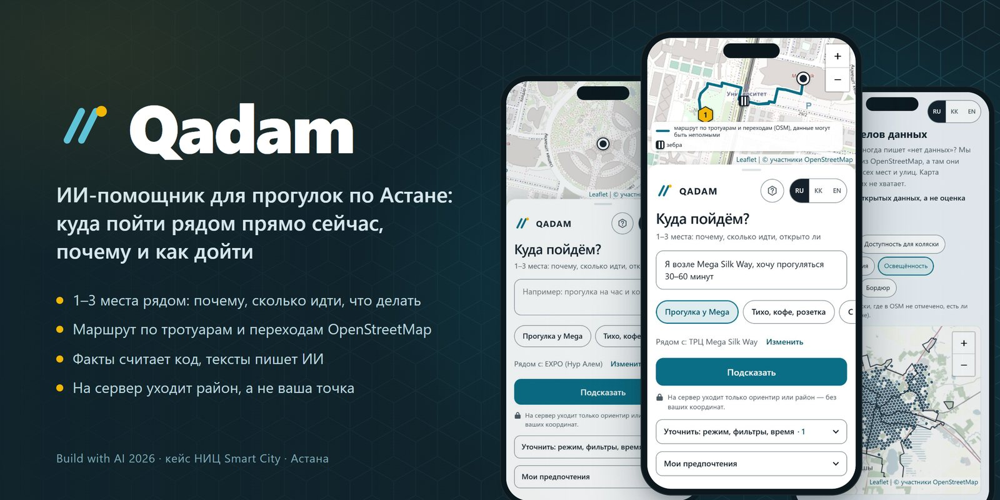

Вы пишете, чего хочется («прогуляться час и выпить кофе»), выбираете ориентир или свой район — и получаете 1–3 места рядом. У каждого места сказано, почему оно подходит, сколько идти, открыто ли оно и что там делать. Маршрут проложен по тротуарам и переходам. Что взято из данных, а что предложил ИИ, видно сразу.

Проект сделан на хакатоне Build with AI, кейс НИЦ Smart City.

> [!NOTE]
> Эта ветка (`wave-9`) — версия после сдачи: маршрут под человека, события, «Мои предпочтения», карта пробелов данных. Сданная версия — тег [`submission-2026-10-19`](https://github.com/Batyrkhan121/Hacathon-Build-with-AI-/tree/submission-2026-10-19).

## Демо

<table>
<tr>
<td width="320" align="center">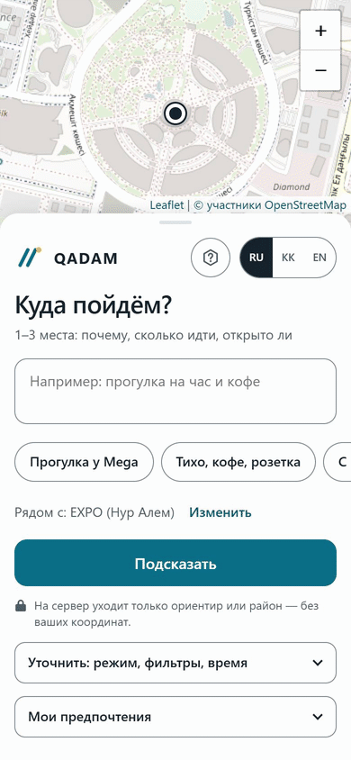</td>
<td>

**Основной сценарий за 16 секунд.** Главный экран → карточки «почему» и «что делать» → маршрут на карте → «Без ступенек» → событие рядом (тестовое) → район вместо точки → карта пробелов данных. Все кадры сняты на живом сервере с Claude.

- 🎬 Видео: _ссылка появится здесь_ <!-- VIDEO_URL: вставить ссылку на демо-видео -->
- 🖼 [Слайды (PDF)](docs/slides.pdf)
- 🎤 [Сценарий выступления](docs/PITCH.md) · [вопросы и ответы для жюри](docs/QA.md)
- 🌐 Публичное демо: _ссылка появится после запуска_ <!-- DEMO_URL: вставить после «да» Megah и проверки -->
- 🏁 Сдано на Build with AI 19.10.2026, тег [`submission-2026-10-19`](https://github.com/Batyrkhan121/Hacathon-Build-with-AI-/tree/submission-2026-10-19)

</td>
</tr>
</table>

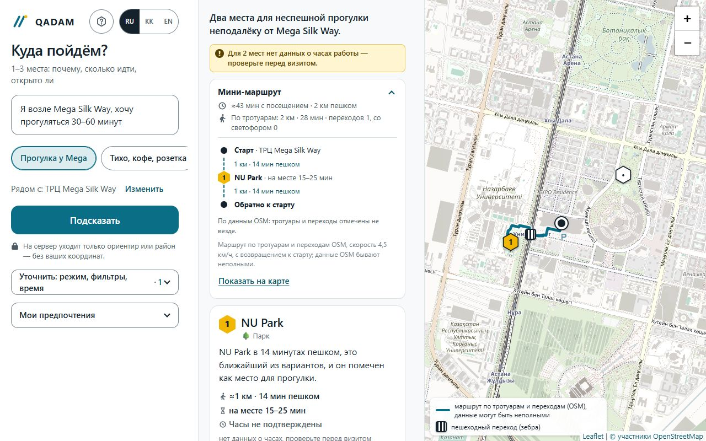

## Что умеет

<table>
<tr>
<td width="50%" valign="top" align="center">
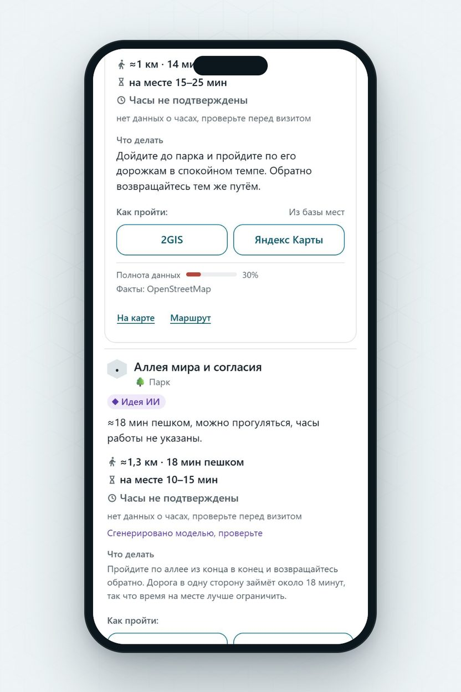
<h3>Карточки «почему» и «что делать»</h3>
<p align="left">1–3 места: почему подходит, сколько идти, сколько пробыть и что делать. Метка «Из базы мест» — идея из данных о месте, «Идея ИИ» — её предложил ИИ.<br><b>Зачем:</b> сразу видно, чему верить. Минуты, расстояние и часы работы считает код, а не ИИ.</p>
</td>
<td width="50%" valign="top" align="center">
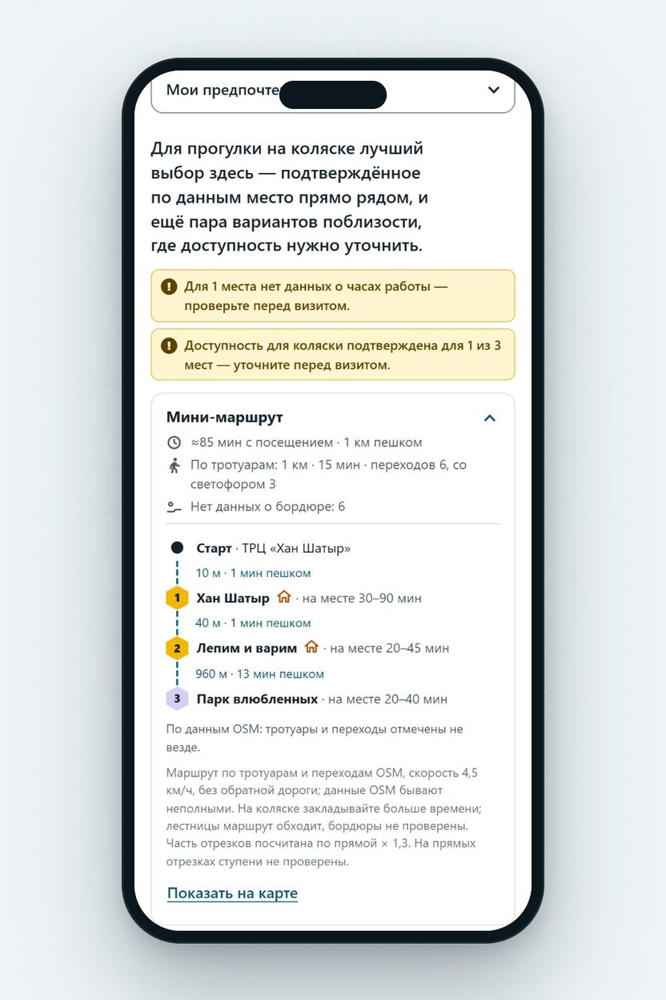
<h3>Маршрут по тротуарам и «Без ступенек»</h3>
<p align="left">Мини-маршрут идёт по пешеходной сети OpenStreetMap: видно, сколько переходов и сколько из них со светофором. «Без ступенек» обходит лестницы.<br><b>Зачем:</b> с коляской или чемоданом важно не упереться в ступени. Если часть пути посчитана по прямой, Qadam так и пишет.</p>
</td>
</tr>
<tr>
<td width="50%" valign="top" align="center">
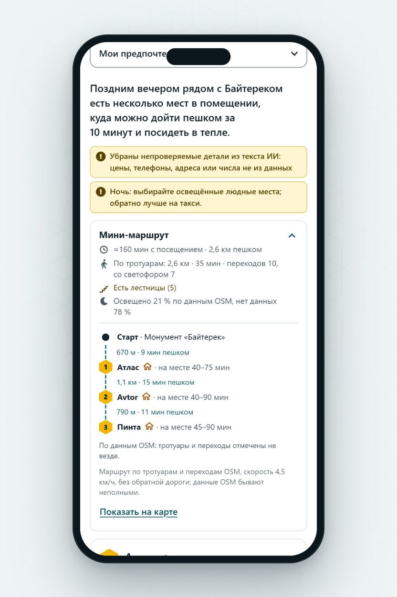
<h3>«Ночью — по крупным улицам»</h3>
<p align="left">Маршрут держится крупных улиц и показывает, какая доля пути освещена по данным OSM и где данных нет.<br><b>Зачем:</b> поздно вечером спокойнее идти по большим улицам. Qadam не называет путь «безопасным» — только «освещено по данным OSM».</p>
</td>
<td width="50%" valign="top" align="center">

<h3>Мороз и «В тепле»</h3>
<p align="left">В мороз (−10 °C и ниже) Qadam предлагает места в помещении и короткие отрезки по улице, тёплые места — со значком-домиком. «В тепле» можно выбрать и самому, как на снимке.<br><b>Зачем:</b> зимой в Астане гулять по парку не хочется. Погоду мы не подменяем: плашка мороза — только при настоящем морозе.</p>
</td>
</tr>
<tr>
<td width="50%" valign="top" align="center">
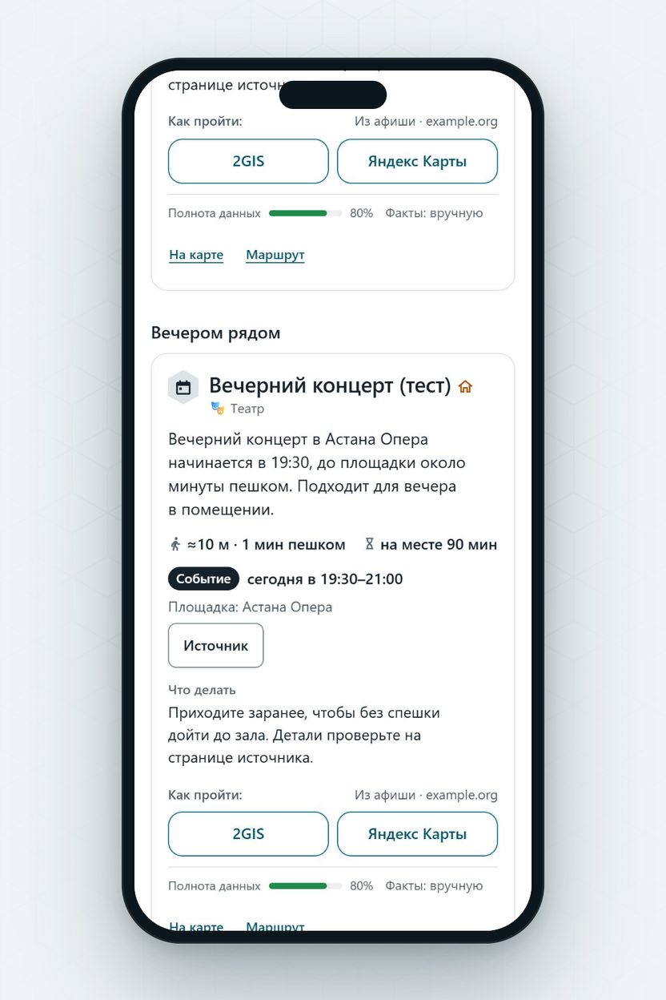
<h3>«Вечером рядом» — события с источником</h3>
<p align="left">У события есть время, площадка и ссылка на источник. Если до начала больше 30 минут, оно не становится остановкой маршрута, а показывается отдельно: «Вечером рядом», «Позже рядом» или «Завтра рядом».<br><b>Зачем:</b> видно, что успеете и откуда сведения. Живых событий пока нет: на снимке — тестовое, оно так и подписано.</p>
</td>
<td width="50%" valign="top" align="center">
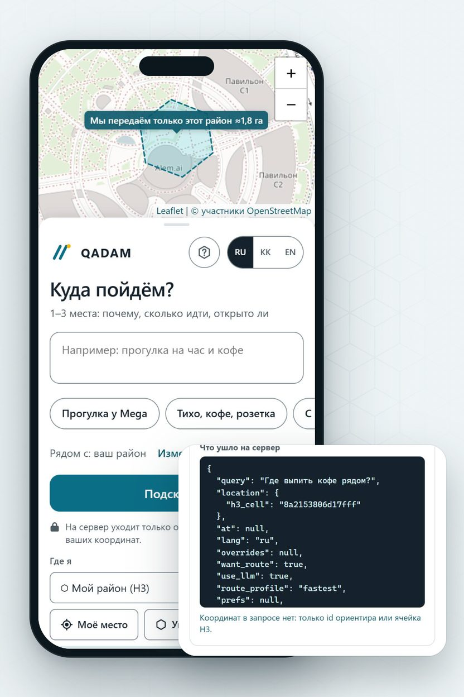
<h3>Район вместо точки</h3>
<p align="left">Вместо вашей точки на сервер уходит шестиугольник района около 1,8 га (ячейка H3). Блок «Что ушло на сервер» показывает запрос целиком.<br><b>Зачем:</b> можно проверить самому, что координат в запросе нет.</p>
</td>
</tr>
<tr>
<td width="50%" valign="top" align="center">
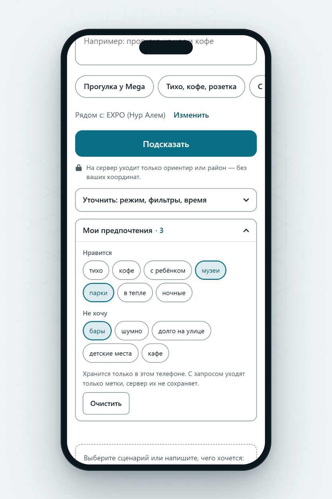
<h3>«Мои предпочтения» — только в телефоне</h3>
<p align="left">Метки «нравится» и «не хочу» (музеи, парки, бары, кафе…) хранятся в браузере телефона. С запросом уходят только метки, сервер их не сохраняет. «Очистить» стирает всё.<br><b>Зачем:</b> ответы под вас без аккаунта и без истории на сервере.</p>
</td>
<td width="50%" valign="top" align="center">
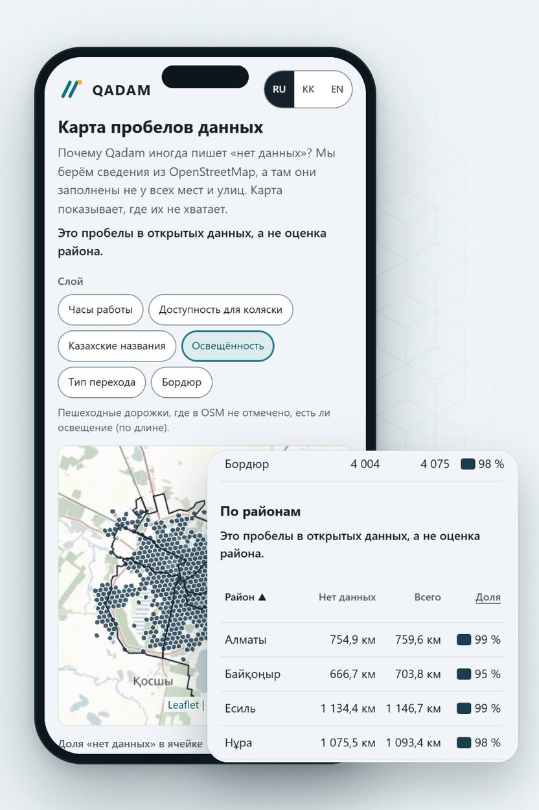
<h3>Карта пробелов данных</h3>
<p align="left">Где в OpenStreetMap не хватает сведений: часы работы, доступность для коляски, казахские названия, освещение, тип перехода, бордюр — по шестиугольникам и по 6 районам Астаны. «Как помочь»: StreetComplete (Android) и Every Door (iPhone).<br><b>Зачем:</b> видно, что дополнить. Это пробелы в открытых данных, а не оценка района.</p>
</td>
</tr>
</table>

### На трёх языках

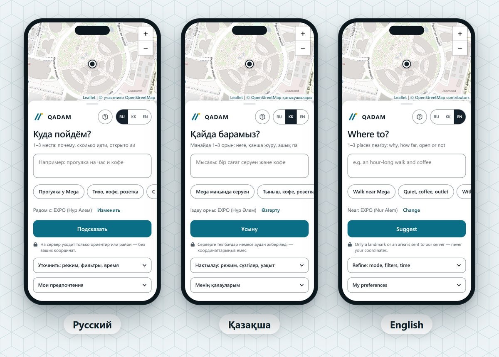

## Как это работает

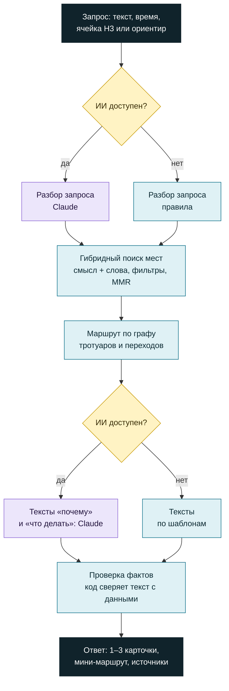

> **Факты считает код, тексты пишет ИИ.** Расстояние, минуты пешком, часы работы, адрес и маршрут берутся из данных. ИИ пишет только «почему» и «что делать» — и только про те места, которые ему передал поиск. Перед ответом код проверяет текст ИИ и убирает то, чего нет в данных: цены, телефоны, «открыто сейчас» без подтверждения. Если ИИ недоступен или его дневной лимит исчерпан, ответ всё равно приходит: правила разбирают запрос, тексты собираются по шаблонам, и об этом честно сказано.

Подробнее — [как устроен RAG](docs/RAG.md) и [архитектура](docs/ARCHITECTURE.md).

## Приватность и честность

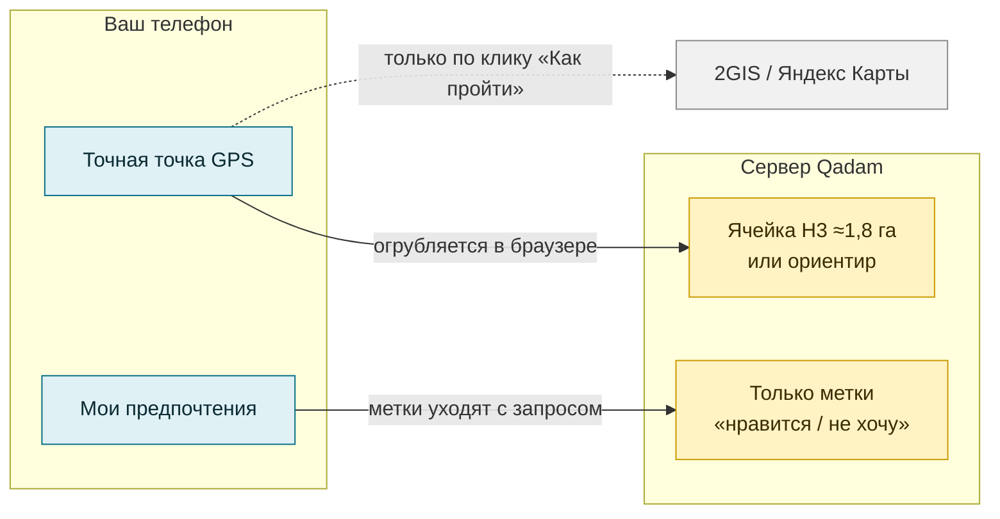

- 🔒 **Только район или ориентир.** Сервер принимает ячейку H3 не мельче r10 (≈1,8 га) или название ориентира; сырые координаты он отклоняет.
- 📍 **Точная точка остаётся в телефоне.** Она уходит лишь в 2GIS или Яндекс Карты — когда вы сами нажимаете «Как пройти» при выбранном «Моё место».
- 🏷 **Предпочтения — только метками.** Без свободного текста и без истории; сервер их не сохраняет и не пишет в журнал.
- 🕒 **«Открыто сейчас» — только при высокой уверенности.** Иначе: «нет данных о часах, проверьте перед визитом».
- ❔ **«Нет данных» никогда не превращается в «да».** Нет сведений об освещении, бордюре или доступности — так и пишем.

Подробнее: [этика и приватность](docs/ETHICS.md).

## Данные

| Что | Сколько | Источник и дата |
|---|---|---|
| Места | **1222**; у 15 есть ссылка на Wikidata, 37 описаний написал Claude (с пометкой) | OpenStreetMap, снимки с 01.06 по 18.10.2026 |
| Пешеходная сеть | **60 820** узлов, **85 936** отрезков, **5532,5 км**; 4075 переходов | OpenStreetMap, снимки с 31.05 по 18.10.2026 |
| Нет сведений об освещении | 5372,7 из 5532,5 км пути — **97,1 %** | карта пробелов, собрана 22.10.2026 |
| Нет сведений о бордюре на переходе | 4004 из 4075 — **98,3 %** | там же |
| Тип перехода не указан | 1385 из 4075 — **34,0 %** | там же |
| Нет часов работы | 884 из 1222 мест — **72,3 %** | там же |
| Неизвестна доступность для коляски | 1155 из 1222 — **94,5 %** | там же |
| Нет названия на казахском | 1149 из 1222 — **94,0 %** | там же |

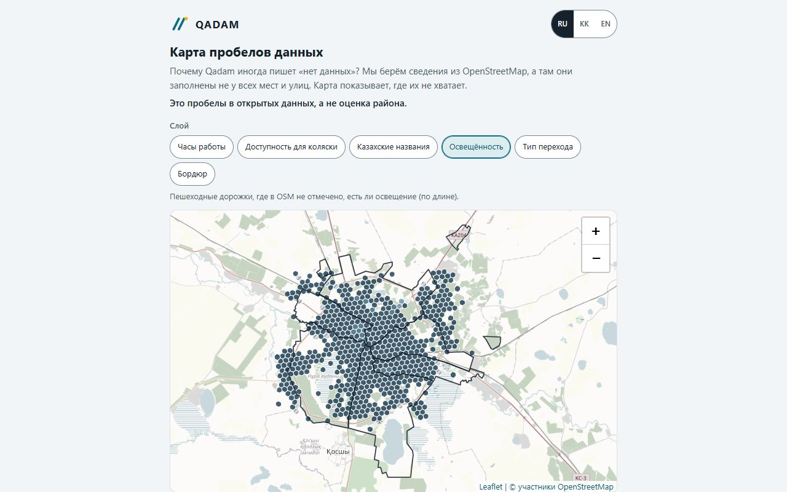

По районам доля пути без сведений об освещении — от 90,8 % до 99,4 %. Числа взяты из [отчёта о данных](data/processed/REPORT.md) и файла [карты пробелов](data/processed/city_gaps.json); как они собраны — в [описании данных](docs/DATA.md).

## Качество

| Проверка | Результат | На чём |
|---|---|---|
| pytest | **1597 прошли**, 1 пропущен | `wave-9` `5a63e63` |
| eval без ИИ | **22/22** (16 основных и 6 волны 8) | `wave-9` `5a63e63` |
| Пробы приватности | **9/9** | `wave-9` `5a63e63` |
| Проверка карты пробелов | **29/29** | `wave-9` `5a63e63` |
| eval с Claude | **22/22** · на сдаче 16/16 с Claude и 16/16 без ИИ | `wave-8` `937c33a` · `main` |
| Docker smoke | **34/34**; 21-й запрос за минуту с одного адреса → 429 | образ из `5a63e63` |
| Интерфейс | node-тесты **58/58** | `wave-9` `5a63e63` |

Сценарии, условия и все прогоны — в [сценариях и ограничениях](docs/SCENARIOS.md).

## Ограничения

- **Живых событий пока нет.** Источники проверяют люди; события в демо и на снимках — тестовые и так подписаны.
- **В OpenStreetMap мало сведений** об освещении (97,1 % пути без них) и бордюрах (98,3 % переходов), поэтому чаще звучит «нет данных».
- **Ответ с ИИ — несколько секунд:** медиана 7,6 с, от 7,0 до 10,5 с (прогон сдачи, пустой кэш). Без ИИ — миллисекунды.
- **Часы работы известны лишь у 27,7 % мест** — чаще всего Qadam просит проверить их перед визитом.
- **Публичного адреса пока нет:** запуск ждёт решения команды; на бесплатном хостинге возможен холодный старт.

## Запуск

Окружение (один раз):

```bash
python -m venv .venv
.venv/Scripts/python -m pip install -r requirements.txt   # macOS/Linux: .venv/bin/python
```

<details>
<summary><b>Только интерфейс, на моке</b> — без сервера и ключей</summary>

```bash
.venv/Scripts/python -m http.server 5500
```

Откройте http://localhost:5500/web/?mock=1. Ответы берутся из `web/mock/answer_sample.json`.

</details>

<details>
<summary><b>Всё приложение без ключей</b> — правила, шаблоны, поиск по словам</summary>

```bash
.venv/Scripts/python -m uvicorn app.api:app --port 8000 --no-access-log
```

Откройте http://localhost:8000, карта пробелов — http://localhost:8000/gaps.html.

</details>

<details>
<summary><b>С ключами</b> — тексты Claude и поиск по смыслу</summary>

Скопируйте `.env.example` в `.env` и впишите `ANTHROPIC_API_KEY` и, по желанию, `OPENROUTER_API_KEY`; запуск тот же. Проверка окружения: `.venv/Scripts/python scripts/check_env.py --llm`. Файл `.env` не коммитьте.

</details>

<details>
<summary><b>Docker</b></summary>

```bash
docker build -t qadam .
docker run --rm -p 7860:7860 qadam
```

Откройте http://localhost:7860. В образе включены лимиты: 20 запросов в минуту и 300 в сутки с одного адреса.

</details>

## Стек

| Часть | Что внутри |
|---|---|
| Сервер | Python 3.11+, FastAPI, Pydantic v2, numpy (векторный индекс в памяти), h3, httpx |
| ИИ | Claude `claude-sonnet-5-5`, запасная `claude-haiku-5-5`; эмбеддинги по желанию — `google/gemini-embedding-001` через OpenRouter |
| Интерфейс | HTML, CSS, JavaScript без сборки; Leaflet и h3-js лежат в `web/vendor` |
| Данные | OpenStreetMap, Wikidata, Open-Meteo |
| Проверки | pytest, node --test, ruff, eval, Docker smoke |

<details>
<summary><b>Структура репозитория</b></summary>

```text
app/        сервер: разбор запроса, поиск, маршрут, тексты, проверка фактов, API
web/        интерфейс без сборки; web/vendor — Leaflet и h3-js
pipeline/   сбор данных: OSM, Wikidata, граф тротуаров, карта пробелов
data/       места, индекс, граф, карта пробелов, ориентиры
prompts/    промпты для Claude
eval/       сценарии и автоматическая проверка
tests/      pytest
docs/       концепция, архитектура, этика, данные, слайды, сценарии
```

</details>

<details>
<summary><b>Все скриншоты</b> (живой сервер, телефон 390 px)</summary>

<table>
<tr>
<td align="center">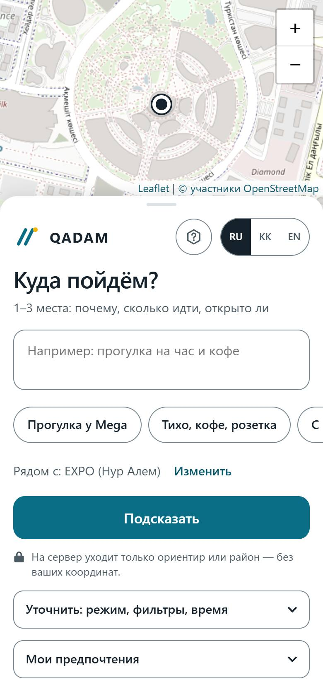<br>Главный экран</td>
<td align="center">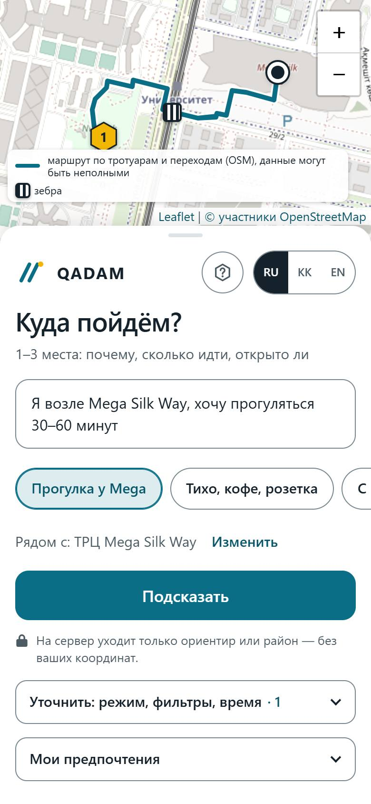<br>Маршрут на карте</td>
<td align="center">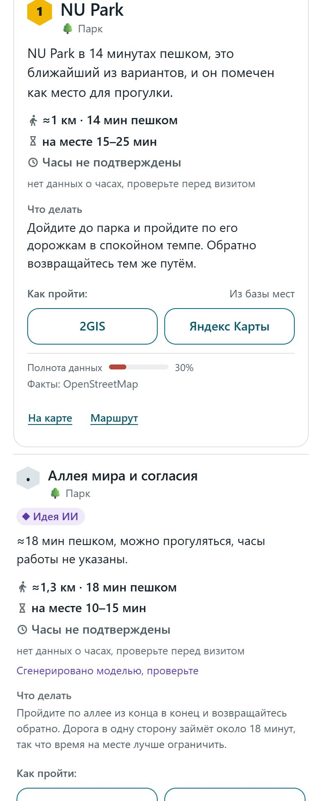<br>Карточки</td>
<td align="center">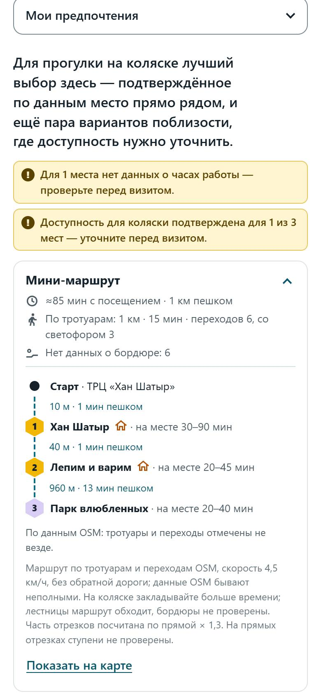<br>Без ступенек</td>
</tr>
<tr>
<td align="center">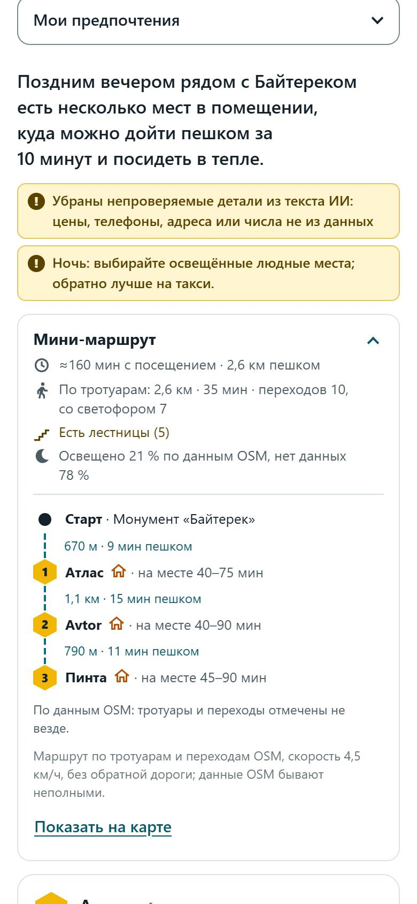<br>Ночью</td>
<td align="center">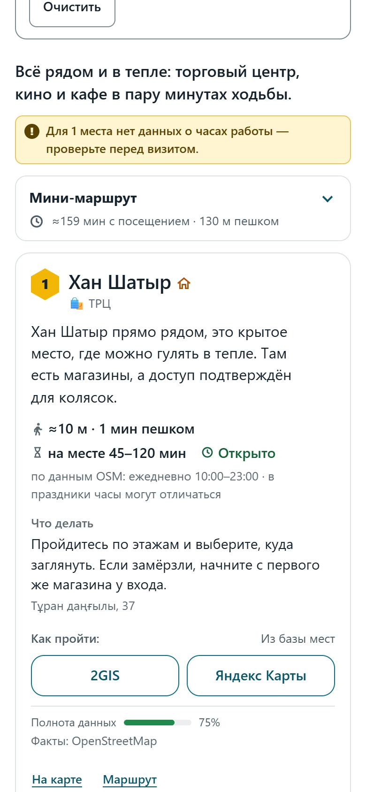<br>В тепле</td>
<td align="center">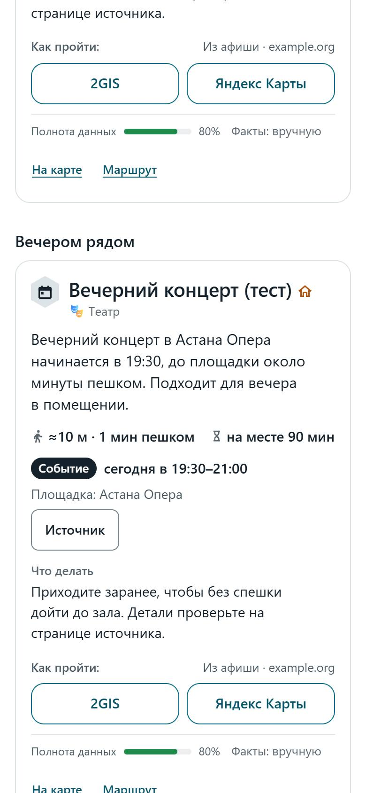<br>Вечером рядом</td>
<td align="center">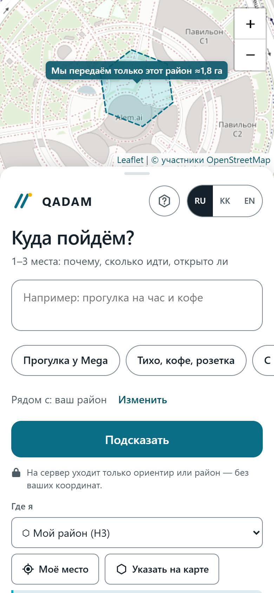<br>Район вместо точки</td>
</tr>
<tr>
<td align="center">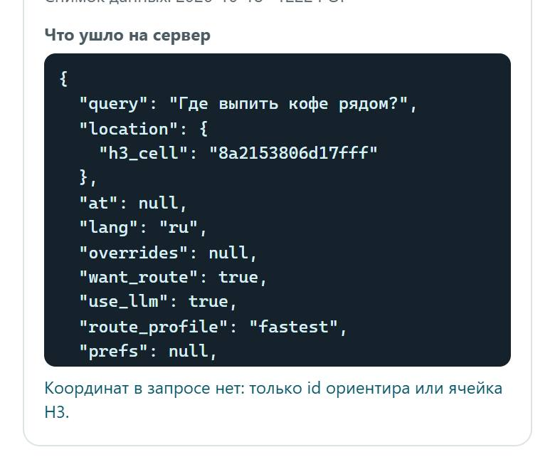<br>Что ушло на сервер</td>
<td align="center">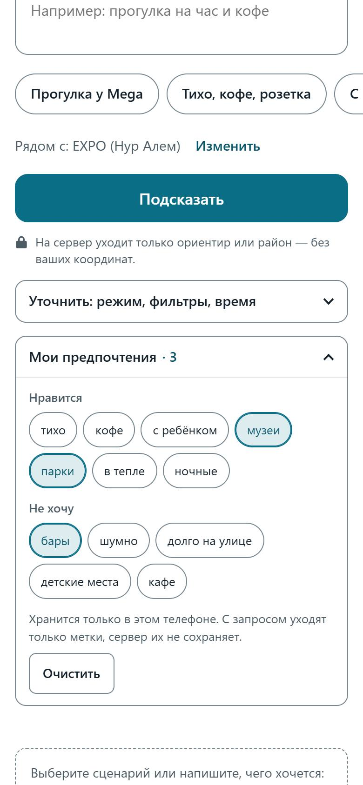<br>Мои предпочтения</td>
<td align="center">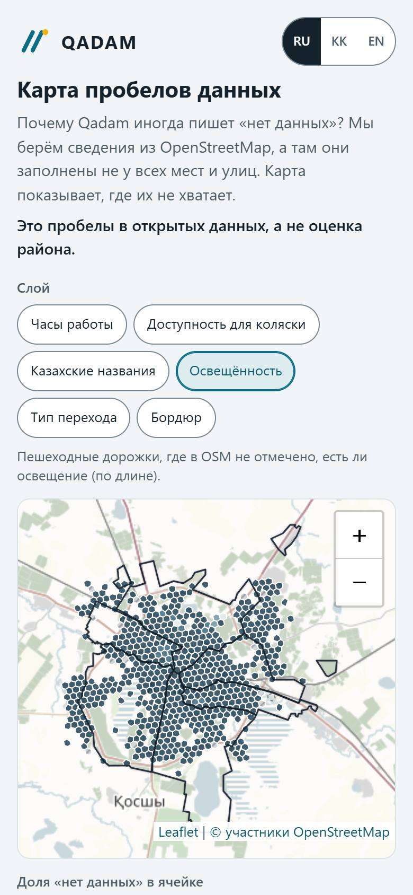<br>Карта пробелов</td>
<td align="center">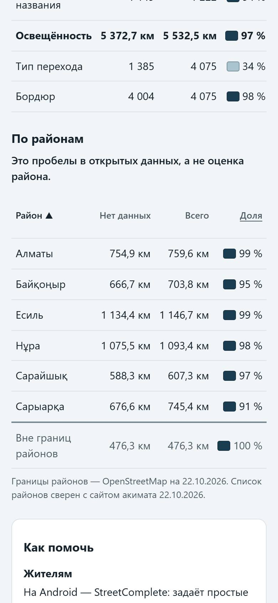<br>По районам</td>
</tr>
<tr>
<td align="center">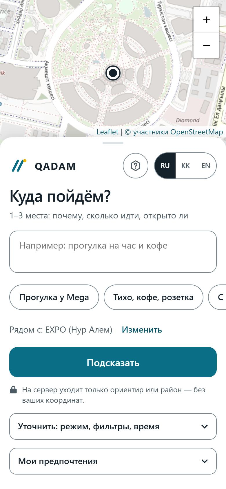<br>Русский</td>
<td align="center">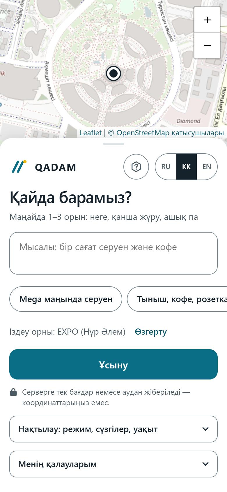<br>Қазақша</td>
<td align="center">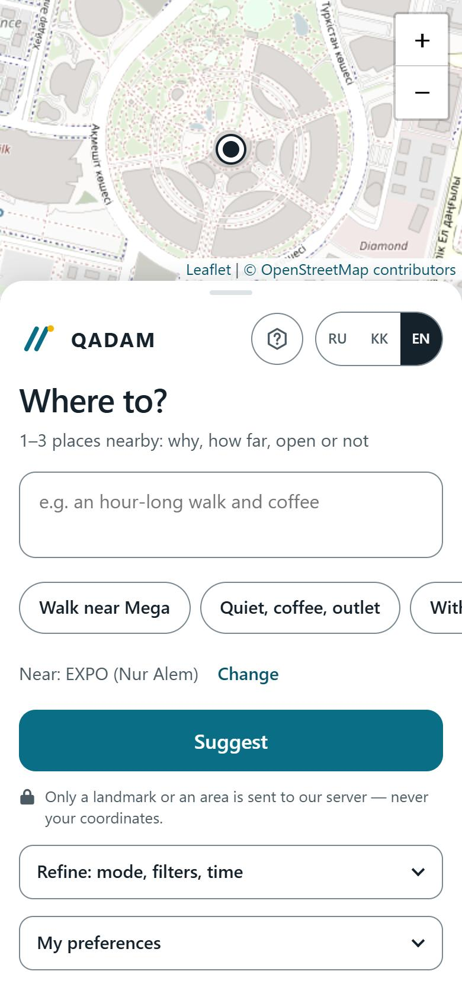<br>English</td>
<td align="center"><br>Широкий экран</td>
</tr>
</table>

</details>

## Команда

| | Роль |
|---|---|
| **Megah** | продукт: что строим и какие решения принимаем |
| **Батырхан** | разработка и интеграция; код писали параллельные сессии Claude Code |
| **Meyrban** | Docker и публикация |

## Лицензии и атрибуция

- Код — [MIT](LICENSE).
- Данные OpenStreetMap и производные от них базы (`data/processed/poi.jsonl`, `data/processed/walk_graph.npz`, `data/processed/city_gaps.json`) — [ODbL 1.0](https://opendatacommons.org/licenses/odbl/1-0/), © [участники OpenStreetMap](https://www.openstreetmap.org/copyright). Тайлы карты — OpenStreetMap.
- Wikidata — [CC0](https://creativecommons.org/publicdomain/zero/1.0/). Погода — [Open-Meteo](https://open-meteo.com/) (CC BY 4.0).
- 2GIS и Яндекс Карты: данные оттуда не берём; кнопка «Как пройти» только открывает ссылку на их сайт.

## English summary

**Qadam is an AI walking assistant for Astana: where to go nearby right now, why, and how to get there.**
You type what you feel like and pick a landmark or your area; Qadam answers with 1–3 places, each with «why», «what to do», walking time and opening hours, and a short route along sidewalks and crossings.
Facts (distances, minutes, hours, the route) are computed by code from OpenStreetMap data; Claude only writes the «why» and «what to do» texts, and code checks them against the data. Without AI the answer still comes from rules and templates.
Privacy: the server receives only an H3 cell (≥ r10, about 1.8 ha) or a landmark — never raw coordinates; preferences stay on the phone.
After the hackathon: step-free and night routes, warm places in frost, events with sources, and a data gaps map showing where OpenStreetMap lacks information (97.1 % of the walking network has no lighting info).
Built for Build with AI 2026 (NIC Smart City case). Code: MIT; data: ODbL © OpenStreetMap contributors.

## Қазақша

**Qadam — Астанада серуендеуге арналған ЖИ-көмекші: дәл қазір жақын жерде қайда баруға болады, неге және қалай жетуге болады.**
Сервер нақты координатаны емес, тек аудан ұяшығын (H3) немесе бағдарды алады; интерфейс — қазақ, орыс және ағылшын тілдерінде.
Деректер — OpenStreetMap (ODbL); фактілерді код есептейді, ЖИ тек «неге» және «не істеу керек» мәтіндерін жазады.
