<p align="center">
  
</p>

<h1 align="center">Qadam</h1>

<p align="center"><b>ИИ-помощник для прогулок по Астане: куда пойти рядом прямо сейчас, почему и как дойти.</b></p>

<p align="center">
  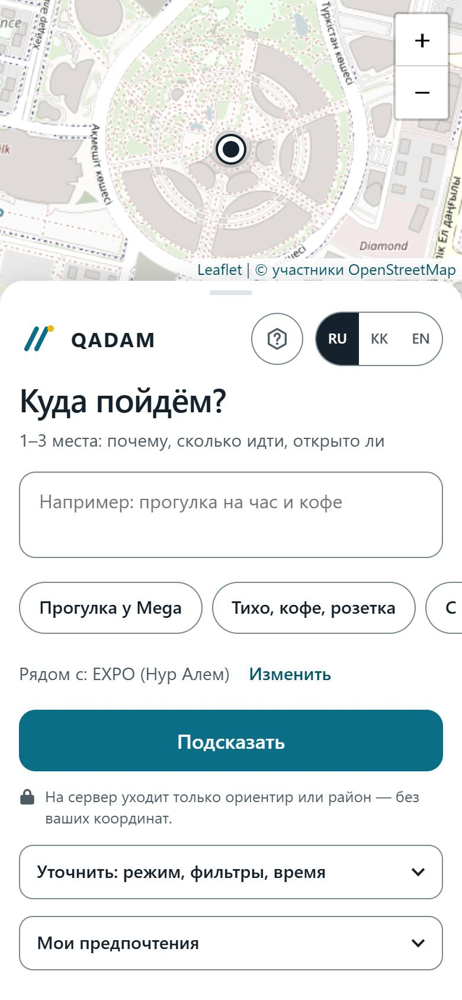
  &nbsp;&nbsp;
  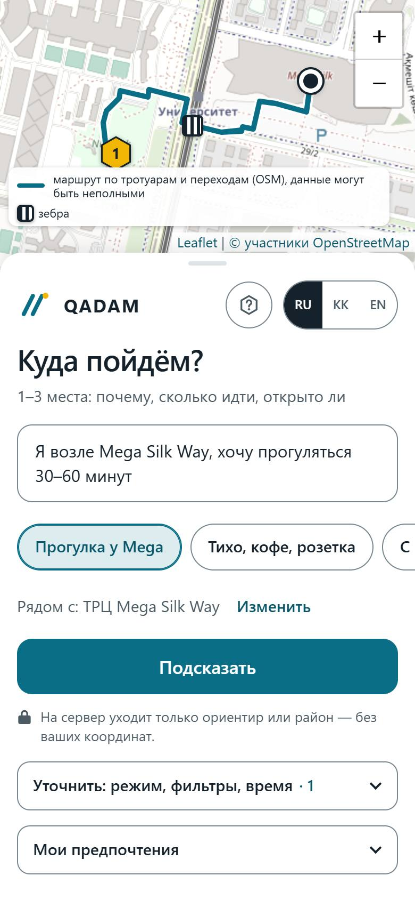
</p>

Вы пишете, чего хочется («прогуляться час и выпить кофе»), выбираете ориентир или свой район — и получаете 1–3 места рядом. У каждого места сказано, почему оно подходит, сколько идти, открыто ли оно и что там делать. Маршрут проложен по тротуарам и переходам. У каждого факта есть источник: что взято из данных, а что придумал ИИ, видно сразу.

Проект сделан на хакатоне Build with AI, кейс НИЦ Smart City.

> Эта ветка (`wave-9`) — версия после сдачи: маршрут под человека, события, «Мои предпочтения», карта пробелов данных. Сданная версия — тег [`submission-2026-10-19`](https://github.com/Batyrkhan121/Hacathon-Build-with-AI-/tree/submission-2026-10-19).

## Демо

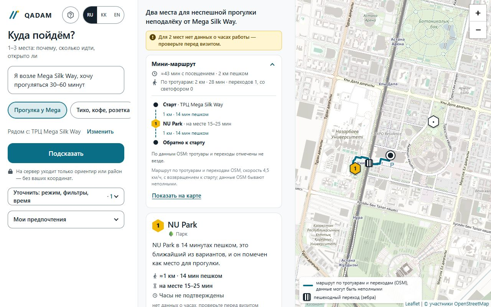

- Видео: _ссылка появится здесь_ <!-- VIDEO_URL: вставить ссылку на демо-видео -->
- [Слайды (PDF)](docs/slides.pdf) · [сценарий выступления](docs/PITCH.md) · [вопросы и ответы для жюри](docs/QA.md)
- Публичное демо: _ссылка появится после запуска_ <!-- DEMO_URL: вставить после «да» Megah и проверки -->
- Сдано на Build with AI 19.10.2026, тег [`submission-2026-10-19`](https://github.com/Batyrkhan121/Hacathon-Build-with-AI-/tree/submission-2026-10-19).

## Что умеет

<table>
<tr>
<td width="280">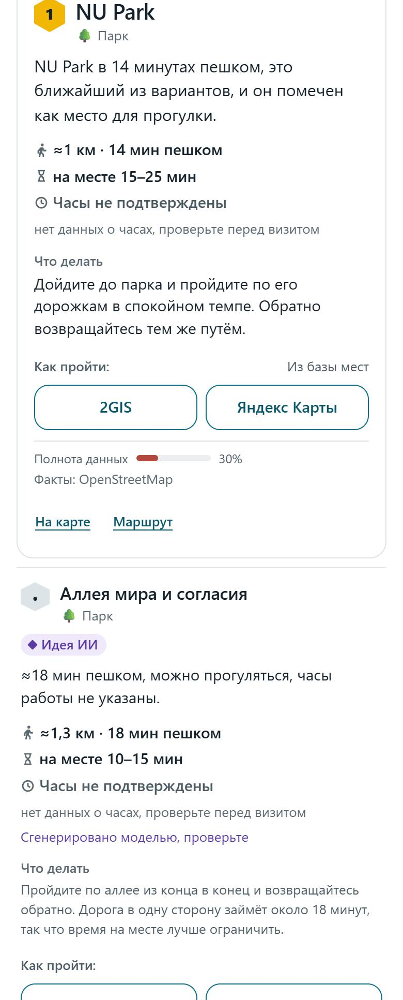</td>
<td><b>Карточки «почему» и «что делать».</b> 1–3 места: почему подходит, сколько идти, сколько там пробыть и что делать. Метка «Из базы мест» — идея взята из данных о месте, «Идея ИИ» — её предложил ИИ.<br><br><i>Зачем:</i> сразу видно, чему верить. Минуты, расстояние и часы работы считает код, а не ИИ.</td>
</tr>
<tr>
<td>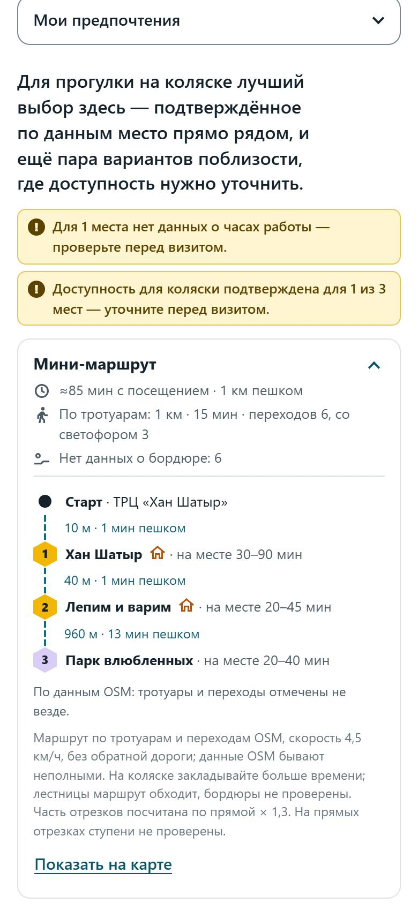</td>
<td><b>Маршрут по тротуарам и переходам.</b> Мини-маршрут идёт по пешеходной сети OpenStreetMap: видно, сколько переходов и сколько из них со светофором. Режим «Без ступенек» обходит лестницы.<br><br><i>Зачем:</i> с коляской или чемоданом важно не упереться в ступени. Если часть пути посчитана по прямой, Qadam так и пишет, а не обещает.</td>
</tr>
<tr>
<td>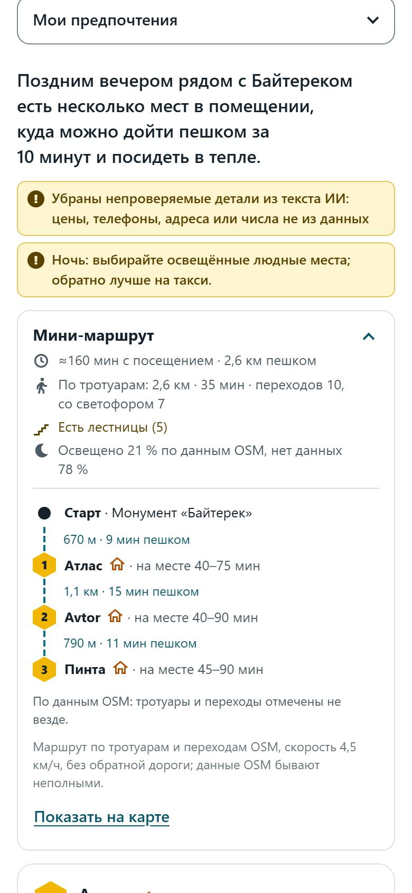</td>
<td><b>«Ночью — по крупным улицам».</b> Маршрут держится крупных улиц и показывает, какая доля пути освещена по данным OSM и где данных нет.<br><br><i>Зачем:</i> поздно вечером спокойнее идти по большим улицам. Qadam не называет путь «безопасным» — только «освещено по данным OSM».</td>
</tr>
<tr>
<td>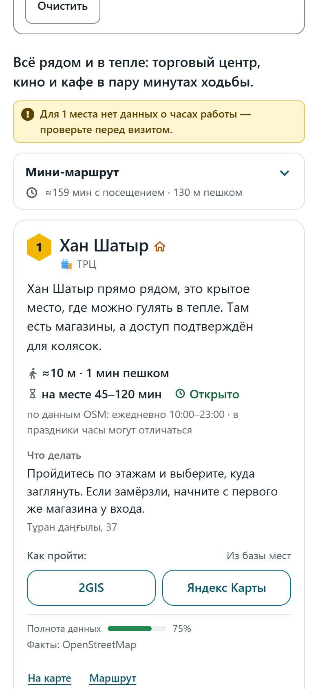</td>
<td><b>Мороз и «В тепле».</b> Когда на улице мороз (−10 °C и ниже), Qadam предлагает места в помещении и короткие отрезки по улице, тёплые места — со значком-домиком. «В тепле» можно выбрать и самому, как на снимке.<br><br><i>Зачем:</i> зимой в Астане гулять по парку не хочется. Погоду мы не подменяем: плашка мороза появляется только при настоящем морозе.</td>
</tr>
<tr>
<td>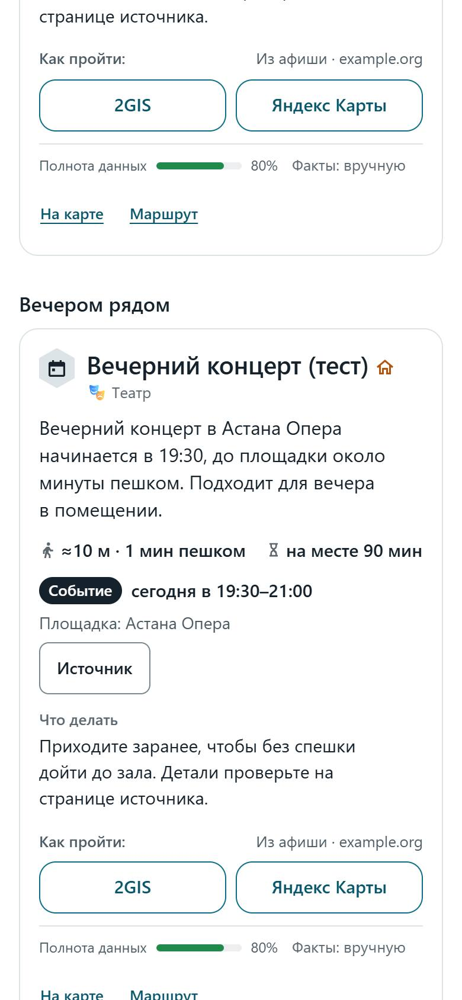</td>
<td><b>«Вечером рядом» — события с источником.</b> У события есть время, площадка и ссылка на источник. Если до начала больше 30 минут, оно не становится остановкой маршрута, а показывается отдельно: «Вечером рядом», «Позже рядом» или «Завтра рядом».<br><br><i>Зачем:</i> видно, что успеете, и откуда эти сведения. Живых событий пока нет: на снимке — тестовое событие, оно так и подписано.</td>
</tr>
<tr>
<td>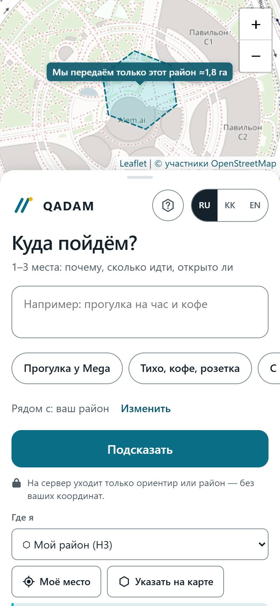<br>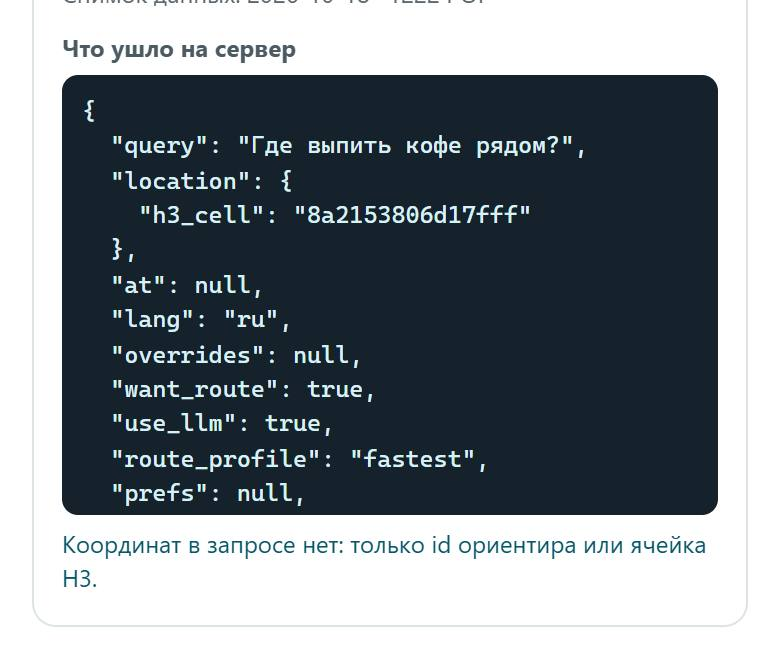</td>
<td><b>Приватность: район вместо точки.</b> Вместо вашей точки на сервер уходит шестиугольник района около 1,8 га (ячейка H3). Блок «Что ушло на сервер» показывает запрос целиком.<br><br><i>Зачем:</i> можно проверить самому, что координат в запросе нет.</td>
</tr>
<tr>
<td>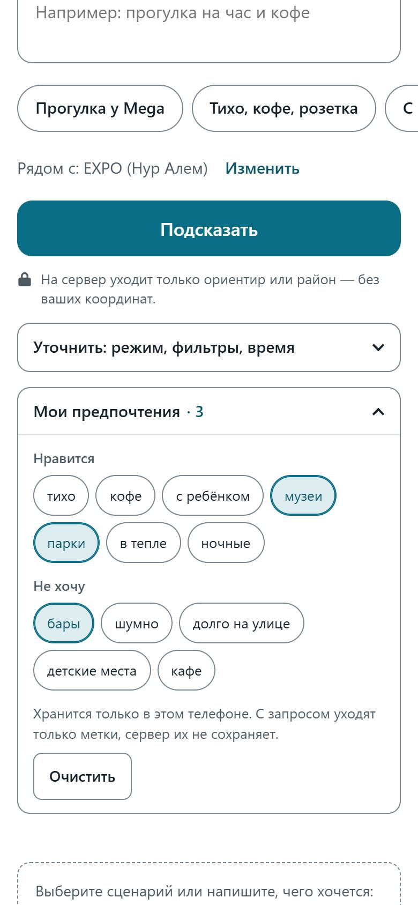</td>
<td><b>«Мои предпочтения» только в телефоне.</b> Метки «нравится» и «не хочу» (музеи, парки, бары, кафе…) хранятся в браузере вашего телефона. С запросом уходят только метки, сервер их не сохраняет. Кнопка «Очистить» стирает всё.<br><br><i>Зачем:</i> ответы под вас без аккаунта и без истории на сервере.</td>
</tr>
<tr>
<td>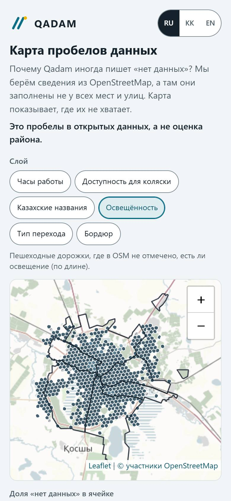<br>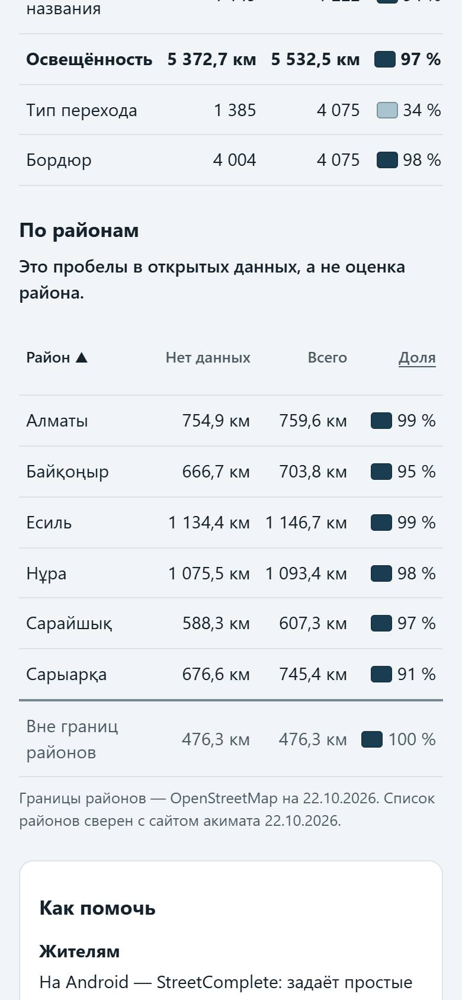</td>
<td><b>«Карта пробелов данных».</b> Где в открытых данных OpenStreetMap не хватает сведений: часы работы, доступность для коляски, казахские названия, освещение, тип перехода, бордюр. По шестиугольникам и по 6 районам Астаны, районы — по алфавиту. В разделе «Как помочь» — приложения, через которые дополнить OSM: StreetComplete (Android) и Every Door (iPhone).<br><br><i>Зачем:</i> городу и жителям видно, что дополнить. Это пробелы в открытых данных, а не оценка района.</td>
</tr>
</table>

## Как это работает

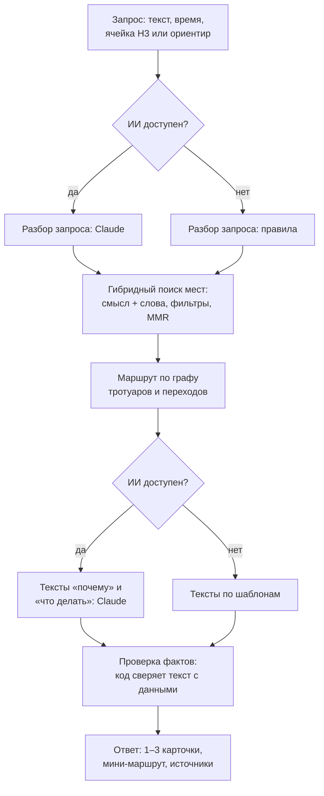

Факты считает код: расстояние, минуты пешком, часы работы, адрес и маршрут берутся из данных. ИИ пишет только «почему» и «что делать» — и только про те места, которые ему передал поиск. Перед ответом код проверяет текст ИИ и убирает то, чего нет в данных: цены, телефоны, «открыто сейчас» без подтверждения. Если ИИ недоступен или его дневной лимит исчерпан, ответ всё равно приходит: запрос разбирают правила, тексты собираются по шаблонам, и об этом честно сказано. Подробнее — [как устроен RAG](docs/RAG.md) и [архитектура](docs/ARCHITECTURE.md).

## Приватность и честность

- **Только район или ориентир.** Сервер принимает ячейку H3 не мельче r10 (≈1,8 га) или название ориентира. Сырые координаты он отклоняет.
- **Точная точка остаётся в телефоне.** Её видит только ваш браузер. Она уходит лишь в 2GIS или Яндекс Карты, когда вы сами нажимаете «Как пройти» при выбранном «Моё место».
- **Предпочтения — только метками.** Без свободного текста и без истории; хранятся в телефоне, сервер их не сохраняет и не пишет в журнал.
- **«Открыто сейчас» — только при высокой уверенности.** Если часов нет или они неоднозначны: «нет данных о часах, проверьте перед визитом».
- **«Нет данных» никогда не превращается в «да».** Нет сведений об освещении, бордюре или доступности — так и пишем.

Подробнее: [этика и приватность](docs/ETHICS.md).

## Данные

| Что | Сколько | Источник и дата |
|---|---|---|
| Места | 1222; у 15 есть ссылка на Wikidata, 37 описаний написал Claude (с пометкой) | OpenStreetMap, снимки с 01.06 по 18.10.2026 |
| Пешеходная сеть | 60 820 узлов, 85 936 отрезков, 5532,5 км; 4075 переходов | OpenStreetMap, снимки с 31.05 по 18.10.2026 |
| Нет сведений об освещении | 5372,7 из 5532,5 км пути — 97,1 % | карта пробелов, собрана 22.10.2026 |
| Нет сведений о бордюре на переходе | 4004 из 4075 — 98,3 % | там же |
| Тип перехода не указан | 1385 из 4075 — 34,0 % | там же |
| Нет часов работы | 884 из 1222 мест — 72,3 % | там же |
| Неизвестна доступность для коляски | 1155 из 1222 — 94,5 % | там же |
| Нет названия на казахском | 1149 из 1222 — 94,0 % | там же |

По районам доля пути без сведений об освещении — от 90,8 % до 99,4 %. Числа взяты из [отчёта о данных](data/processed/REPORT.md) и файла [карты пробелов](data/processed/city_gaps.json); как они собраны — в [описании данных](docs/DATA.md).

## Качество

- **pytest:** 1597 тестов прошли, 1 пропущен (коммит `5a63e63`).
- **eval без ИИ:** 22/22 сценария (16 основных и 6 волны 8), пробы приватности 9/9, проверка карты пробелов 29/29 (коммит `5a63e63`).
- **eval с Claude:** 22/22 на `wave-8` `937c33a`; на сдаче — 16/16 с Claude и 16/16 без ИИ.
- **Docker:** smoke 34/34 на образе из `5a63e63`; 21-й запрос за минуту с одного адреса получает 429, в журнале контейнера нет адресов и текстов запросов.
- **Интерфейс:** node-тесты 58/58.

Сценарии, условия и все прогоны — в [сценариях и ограничениях](docs/SCENARIOS.md).

## Ограничения

- **Живых событий пока нет.** Источники проверяют люди; события в демо и на снимках — тестовые и так подписаны.
- **В OpenStreetMap мало сведений** об освещении (97,1 % пути без них) и бордюрах (98,3 % переходов без них), поэтому чаще звучит «нет данных».
- **Ответ с ИИ — несколько секунд:** медиана 7,6 с, от 7,0 до 10,5 с (прогон сдачи, пустой кэш). Без ИИ — миллисекунды.
- **Часы работы известны лишь у 27,7 % мест:** чаще всего Qadam просит проверить их перед визитом.
- **Публичного адреса пока нет:** запуск ждёт решения команды; на бесплатном хостинге возможен холодный старт.

## Запуск

Окружение (один раз):

```bash
python -m venv .venv
.venv/Scripts/python -m pip install -r requirements.txt   # macOS/Linux: .venv/bin/python
```

**Только интерфейс, на моке** — без сервера и ключей. Запустите из корня и откройте http://localhost:5500/web/?mock=1:

```bash
.venv/Scripts/python -m http.server 5500
```

**Всё приложение без ключей** — разбор правилами, тексты по шаблонам, поиск по словам. Откройте http://localhost:8000:

```bash
.venv/Scripts/python -m uvicorn app.api:app --port 8000 --no-access-log
```

**С ключами** — скопируйте `.env.example` в `.env` и впишите `ANTHROPIC_API_KEY` (тексты Claude) и, по желанию, `OPENROUTER_API_KEY` (поиск по смыслу); затем запуск тот же. Проверка: `.venv/Scripts/python scripts/check_env.py --llm`. Файл `.env` не коммитьте.

**Docker** — откройте http://localhost:7860:

```bash
docker build -t qadam .
docker run --rm -p 7860:7860 qadam
```

## Стек

Python 3.11+, FastAPI, Pydantic v2, numpy (векторный индекс в памяти), h3, httpx. ИИ — Claude (`claude-sonnet-5-5`, запасная `claude-haiku-5-5`); эмбеддинги по желанию — `google/gemini-embedding-001` через OpenRouter. Интерфейс — HTML, CSS и JavaScript без сборки; Leaflet и h3-js лежат в репозитории. Тесты — pytest и node --test, линтер — ruff.

## Структура репозитория

```text
app/        сервер: разбор запроса, поиск, маршрут, тексты, проверка фактов, API
web/        интерфейс без сборки; web/vendor — Leaflet и h3-js
pipeline/   сбор данных: OSM, Wikidata, граф тротуаров, карта пробелов
data/       места, индекс, граф, карта пробелов, ориентиры
prompts/    промпты для Claude
eval/       сценарии и автоматическая проверка
tests/      pytest
docs/       концепция, архитектура, этика, данные, слайды, сценарии
```

## Команда

- **Megah** — продукт: что строим и какие решения принимаем.
- **Батырхан** — разработка и интеграция; код писали параллельные сессии Claude Code.
- **Meyrban** — Docker и публикация.

## Лицензии и атрибуция

- Код — [MIT](LICENSE).
- Данные OpenStreetMap и производные от них базы (`data/processed/poi.jsonl`, `data/processed/walk_graph.npz`, `data/processed/city_gaps.json`) — [ODbL 1.0](https://opendatacommons.org/licenses/odbl/1-0/), © [участники OpenStreetMap](https://www.openstreetmap.org/copyright). Тайлы карты — OpenStreetMap.
- Wikidata — [CC0](https://creativecommons.org/publicdomain/zero/1.0/).
- Погода — [Open-Meteo](https://open-meteo.com/) (CC BY 4.0).
- 2GIS и Яндекс Карты: данные оттуда не берём; кнопка «Как пройти» только открывает ссылку на их сайт.

## English summary

Qadam is an AI walking assistant for Astana: where to go nearby right now, why, and how to get there.
You type what you feel like and pick a landmark or your area; Qadam answers with 1–3 places, each with «why», «what to do», walking time and opening hours, and a short route along sidewalks and crossings.
Facts (distances, minutes, hours, the route) are computed by code from OpenStreetMap data; Claude only writes the «why» and «what to do» texts, and code checks them against the data. Without AI the answer still comes from rules and templates.
Privacy: the server receives only an H3 cell (≥ r10, about 1.8 ha) or a landmark — never raw coordinates; preferences stay on the phone.
After the hackathon: step-free and night routes, warm places in frost, events with sources, and a «data gaps map» showing where OpenStreetMap lacks information (97.1 % of the walking network has no lighting info).
Built for Build with AI 2026 (NIC Smart City case). Code: MIT; data: ODbL © OpenStreetMap contributors.

## Қазақша

Qadam — Астанада серуендеуге арналған ЖИ-көмекші: дәл қазір жақын жерде қайда баруға болады, неге және қалай жетуге болады.
Сервер нақты координатаны емес, тек аудан ұяшығын (H3) немесе бағдарды алады; деректер — OpenStreetMap (ODbL).
